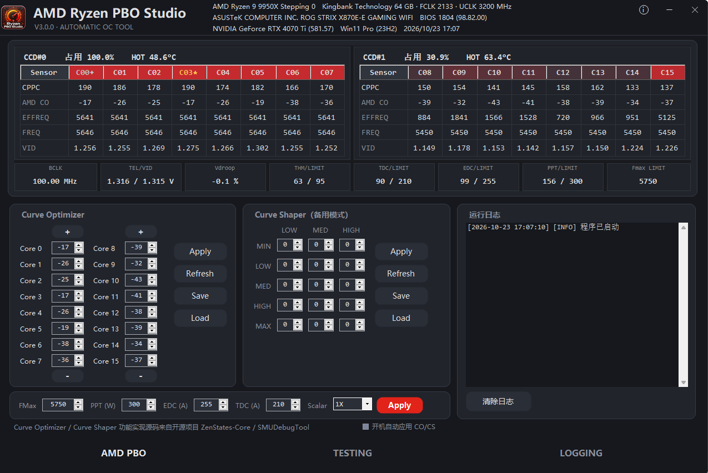

# AMD Ryzen PBO Studio

English | [简体中文](README_zh_cn.md)

A PBO tuning and automated Curve Optimizer (CO) testing tool for AMD Ryzen 5000 / 7000 / 9000 series processors.




> The user interface is in Chinese.

## Features

### Live monitoring

The title bar shows the CPU, motherboard and BIOS, memory, graphics card, and operating system. Below it, a
per-core monitor panel remains visible at all times, grouped by CCD:

- Per-core CPPC ranking (gold / silver core markers), CO value, effective frequency, frequency, and Core VID
- Average utilization and hotspot temperature of each CCD
- BCLK (shown as BCLK/BCLK2 under asynchronous clocking), TEL/VID, Vdroop, THM, TDC, EDC, PPT, and Fmax

### Manual tuning

- **CO**: per-core offsets, with profile save and load
- **Curve Shaper (CS)**: 5 frequency points × 3 temperature points
- **PBO limits**: FMax, PPT, EDC, TDC, and PBO Scalar (1X–10X) applied in one step; options the CPU does not
  support are disabled
- **Apply at startup**: at each Windows logon, applies the saved CO / CS and the FMax, PPT, EDC, and TDC from the
  last Apply on the PBO page; only PBO values that differ from the current values are written, and Scalar is not
  changed. Make sure these settings have passed a stress test before enabling it; if the system restarts
  abnormally after they are applied, the next startup skips them automatically

### Single Core Boost and voltage alignment

Both features are on the **TESTING** page and require a CPU with AVX2 / FMA support:

- **Single Core Boost**: measures the frequency, effective frequency, VID, and Core VID of each core under the
  current CO. It only measures and changes no settings
- **Voltage alignment**: uses the best core in each CCD as the reference and adjusts the CO of the other cores
  so that all cores need similar voltage at the same frequency, then determines the single-core frequency
  ceiling. The result is only entered into the CO editor and is not saved, and
  **it must pass a stress test before use**

### Memory settings

The **MEMORY** page hides the per-core monitor and shows the installed modules and three tables, each listing
the current value and an editable target:

- **Misc & voltages**: MCLK / FCLK / UCLK, BGS, GDM, Cmd2T, PowerDown, SOC, VDDP, VDDG, VDD_MISC, CPU VDDIO,
  DRAM VDD / VDDQ / VPP, and the average DIMM temperature (SPD hub sensor) and power (PMIC); hovering over these
  two shows each module's reading. SOC, VDDP, VDDG, and VDD_MISC are read from the PM table, and DRAM voltages
  are measured by the PMIC on each module; all refresh every 2 seconds
- **Timings**: the timings in use, read from the memory controller, in the order of the ASUS DRAM Timing Control
  menu
- **Signal control**: ProcODT, drive strengths, Rtt, Nitro, and other memory controller options, with current
  values read from the ACPI AOD table

Targets are written through the BIOS `AMD_ACPI` WMI interface (the same interface Ryzen Master uses). Which
items are editable, and their ranges, depend on the motherboard and BIOS. Items the BIOS leaves on Auto show
"Auto" and can be set to a value, but cannot be set back to Auto from the program. CPU VDDIO can be set up to
1550 mV when the BIOS reports a 1400 mV limit.

The installed modules section also shows the DRAM ICs and the EXPO profiles read from the SPD. Each **EXPO**
button fills the targets with that profile's memory frequency, primary timings (tCL, tRCD, tRP, tRAS, tRC, tWR),
tRFC values, and DRAM VDD / VDDQ, rounded up to the nearest value the BIOS accepts, and resets the other DRAM
timings to their BIOS setting (Auto where the BIOS is on Auto, otherwise the current value); pressing it again
restores the previous targets. Nothing is written until **Write to BIOS** is clicked. Those other timings are not
written, so a timing set manually in the BIOS stays at that value; this is not identical to enabling EXPO in the
BIOS. Pending changes are shown in blue.

**Export config** saves the current targets as a memory config file (`.json`). Each entry names the AMD_ACPI
function and holds either `"auto": true` or the raw BIOS `value` (MCLK in MHz for the memory clock, mV for
voltages, the VID for SOC, the option code otherwise); `label` and `display` are only for reading:

```json
{
  "format": "RyzenPboStudio.MemoryConfig",
  "version": 1,
  "source": "targets",
  "memoryType": "DDR5",
  "settings": [
    { "function": "Set Mem Clock", "label": "Memory Frequency", "auto": false, "value": 3200, "display": "DDR5-6400" },
    { "function": "Set VDDIO", "label": "DRAM VDD (V)", "auto": false, "value": 1400, "display": "1.400" },
    { "function": "Set TrrdL", "label": "TrrdL", "auto": true, "display": "Auto" }
  ]
}
```

**Import config** fills the targets from such a file, or from a Cat-girl memoryOC configuration (a memory
configuration or the memory part of a combined profile). Auto entries reset the target to its BIOS setting, and
items this BIOS does not provide are listed in the status line. Like EXPO, it writes nothing by itself.
**Revert changes** puts every target back to its BIOS setting.

Changes are written to the BIOS and **take effect after a reboot and memory training**. Before writing, the
program checks that the function IDs (and, for the memory clock, UCLK DIV1, and PowerDown, the current values)
have not changed since they were read, then backs up the current values to
`profiles\memory_backup_<time>.json` as a memory config file (`"source": "bios"`), which **Import config** can load. Each item is sent as its own
command; sending stops if a command fails. After all items are sent, each one is read back and its status is
shown; a matching readback does not guarantee that the setting takes effect after the reboot. Every command and
its raw return are recorded in `logs\acpi-command-trace.jsonl`.

**Wrong memory settings can prevent the system from booting.** If memory training fails, wait for the BIOS
to fall back or clear the CMOS; the program cannot recover from this

### Automated CO testing

Stress testing uses y-cruncher, with three test modes:

| Mode       | Description                                                                              |
| ---------- | ---------------------------------------------------------------------------------------- |
| Single     | One of VT3, BKT, SVT, BBP, SFTv4, SNT, FFTv4, N63, or YC018                              |
| Sequential | Tests run one after another; by default VT3 → BKT → SVT for 20 / 10 / 10 rounds          |
| Combined   | The selected tests rotate within every round; by default VT3, BKT, and SVT for 10 rounds |

The tests, round counts, and round durations of every mode are customizable. YC018 is a memory-intensive Pi
benchmark whose size is chosen automatically from installed memory; it always uses all cores.

Test scope:

| Scope      | Description                                                  |
| ---------- | ------------------------------------------------------------ |
| All cores  | All cores are stressed together                              |
| Custom     | Only the selected physical cores are stressed                |
| Single CCD | Only the selected CCD is stressed (multi-CCD CPUs only)      |
| Each CCD   | The full test runs on each CCD in turn (multi-CCD CPUs only) |

Single-CCD results are for reference only; confirm final stability with an all-core test.

Offset adjustment:

- **Auto**: when y-cruncher reports an error, the failing core's CO is backed off (+2 by default, with a
  customizable step) and the test is rerun until it passes
- **Manual**: an error only displays a notice and stops the test; no settings are changed

### Crash recovery

If the system freezes or loses power during a test, the program starts automatically after the restart,
backs off the CO, and resumes the unfinished test; you can cancel at any time. For fully unattended
operation, enable automatic logon in Windows.

### Settings and languages

The gear button in the title bar opens the settings: language, checking for updates at startup, the monitor
refresh interval (100–10000 ms, 500 ms by default), and apply at startup.

The program is written in English; translations are plain-text files in the `lang` folder next to the program,
one `<culture>.ini` per language (`zh-Hans.ini` for Simplified Chinese, `zh-Hant.ini` for Traditional Chinese).
By default the language follows the Windows display language and falls back to English. Each line maps the
English text to its translation (`English text=translation`), keeping placeholders such as `{0}`; lines that are
missing or no longer match show in English. A new language is added by copying a file, renaming it to the
culture name (for example `ja.ini`), and setting `name=` under `[meta]`. Language changes apply after a restart.

## Requirements

| Item      | Requirement                                                                   |
| --------- | ----------------------------------------------------------------------------- |
| CPU       | AMD Ryzen 5000 / 7000 / 9000 series                                           |
| OS        | Windows 10 / 11 x64                                                           |
| Runtime   | [.NET 8 Desktop Runtime](https://dotnet.microsoft.com/download/dotnet/8.0)    |
| Driver    | [PawnIO](https://pawnio.eu) (required; the program does not start without it) |
| Privilege | Administrator                                                                 |

Feature support by generation:

| Feature           | 5000 series                   | 7000 series | 9000 series |
| ----------------- | ----------------------------- | ----------- | ----------- |
| CO                | Yes                           | Yes         | Yes         |
| CS                | No                            | No          | Yes         |
| PPT / EDC / TDC   | Yes                           | Yes         | Yes         |
| FMax              | No                            | Yes         | Yes         |
| CPPC core ranking | Requires CPPC enabled in BIOS | Yes         | Yes         |

## Usage

1. Download `-full.zip` (includes y-cruncher) from [Releases](https://github.com/lengmo23/RyzenPboStudio/releases)
   and extract it to any folder. `-update.zip` is used by the in-app updater and does not include y-cruncher;
   do not use it for a first-time installation
2. Run `AMD Ryzen PBO Studio.exe` as administrator
3. On the **AMD PBO** page, confirm that the monitor shows valid readings for per-core frequency and CO values
4. On the **TESTING** page, choose the test mode and scope, then click Start
5. When all tests pass, the run log lists the CO and CS values that passed, and the final offsets are
   also written to `profiles\final_offsets.txt`

The program creates two folders next to its executable:

- `logs\`: the run log of each launch and the log of each y-cruncher run
- `profiles\`: CO history, recovery state, CO / CS profiles, and calibration data

## Warning

PBO and CO tuning are forms of overclocking, and both the CO and CS settings affect system stability. Improper
settings can cause calculation errors, freezes, blue screens, or reboots, and may result in the loss of unsaved
data. Running in an unstable state for extended periods can damage hardware and may affect your warranty.
**Save your work before testing, and do not use the computer while a test is running.**

This program is distributed under the GNU General Public License v3.0 (GPL-3.0) **WITHOUT ANY WARRANTY**,
without even the implied warranty of merchantability or fitness for a particular purpose. The author
accepts no liability for any data loss, hardware damage, or other direct or indirect damages arising
from its use; you use it entirely at your own risk.

## Building from source

```powershell
dotnet publish .\RyzenPboStudio\RyzenPboStudio.csproj -c Release -r win-x64 --self-contained false -p:DebugType=None -p:DebugSymbols=false -o .\bin
```

The build output is written to `bin\`, and the entire folder can be distributed as is. If
`y-cruncher v0.8.7.9547b\` exists in the repository root, the build copies it to `bin\tools\y-cruncher\`;
otherwise this step is skipped.

## Author

[@lengmo23](https://github.com/lengmo23)

Copyright © 2026 [@lengmo23](https://github.com/lengmo23)

## Buy Me a Coffee

AMD Ryzen PBO Studio is an open-source tool I develop independently in my spare time, and every feature has
gone through countless rounds of refinement. If it has saved you time on tuning or helped you get more
performance out of your PC, you are welcome to buy me a coffee! Every contribution helps me keep maintaining
and improving the project, and helps more enthusiasts get a better tuning tool.

Sponsorship is entirely voluntary and does not affect any feature. The same payment codes are also available
from the coffee-cup button in the program's title bar.

<p align="center">
  
  
</p>

## License

This project is released under the [GNU General Public License v3.0](LICENSE). Because it statically links
ZenStates-Core, which is also licensed under GPL-3.0, the project as a whole must be distributed under GPL-3.0.

## Third-party components

- [ZenStates-Core](https://github.com/irusanov/ZenStates-Core) (GPL-3.0): Ryzen SMU access library providing
  read and write interfaces for CO, CS, and PBO parameters
- [SMUDebugTool](https://github.com/irusanov/SMUDebugTool) (GPL-3.0): reference implementation for SMU command
  definitions and PM Table layouts
- [ryzen-smu-cli](https://github.com/rawhide-kobayashi/ryzen-smu-cli) (GPL-3.0): provides the `inpoutx64.dll`
  hardware access component
- [y-cruncher](https://www.numberworld.org/y-cruncher/): stress test engine, copyright Alexander J. Yee

See [THIRD-PARTY-NOTICES.txt](THIRD-PARTY-NOTICES.txt) for the full notices.
