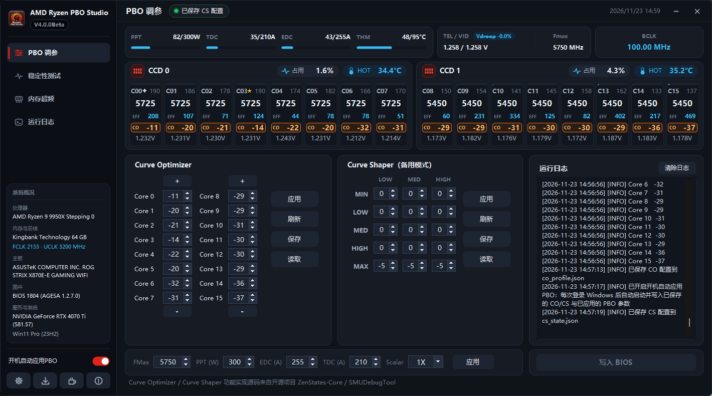
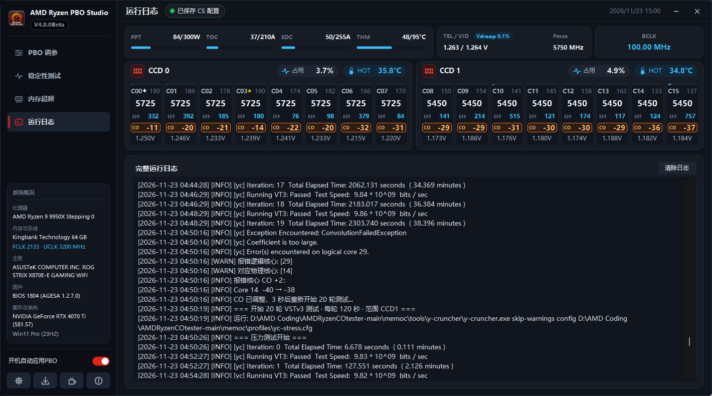

<p align="center">
  <a href="README.md">English</a> ·
  <a href="README_zh_cn.md">简体中文</a> ·
  <a href="README_zh_tw.md">繁體中文</a> ·
  <a href="README_ja.md">日本語</a> ·
  <a href="README_ko.md">한국어</a> ·
  <a href="README_de.md">Deutsch</a> ·
  <a href="README_es.md">Español</a> ·
  <strong>Français</strong> ·
  <a href="README_pt_br.md">Português (Brasil)</a> ·
  <a href="README_ru.md">Русский</a>
</p>

<h1 align="center">AMD Ryzen PBO Studio</h1>

<p align="center">
  Outil de réglage PBO, de test automatique Curve Optimizer (CO) et d'overclocking mémoire pour les processeurs AMD Ryzen séries 5000 / 7000 / 9000.
</p>



## Fonctionnalités

### Interface et suivi en temps réel

La barre latérale gauche permet de basculer entre **Réglage PBO**, **Test de stabilité**, **OC Mémoire** et **Journal d'exécution**, avec en dessous l'**Aperçu système** (processeur, mémoire et FCLK/UCLK en direct, carte mère, BIOS et AGESA, pilote graphique et système) et l'interrupteur **Appliquer PBO au démarrage**.

En haut à droite figure le panneau de suivi par cœur, qui affiche :

- Valeurs actuelles et limites PPT, TDC, EDC et THM
- TEL/VID, Vdroop, Fmax et BCLK (`BCLK/BCLK2` en horloge asynchrone)
- État des cœurs par CCD : charge moyenne et température hotspot (`HOT`) de chaque CCD, plus le classement CPPC (marqueurs or / argent), la fréquence, la fréquence effective (`EFF`), la valeur CO et le Core VID de chaque cœur

### Réglage PBO

- **Curve Optimizer (CO)** : offsets par cœur physique avec ajustement `+/-` par colonne, ainsi qu'appliquer, actualiser, enregistrer et charger
- **Curve Shaper (CS)** : 5 paliers de fréquence (`MIN` / `LOW` / `MED` / `HIGH` / `MAX`) × 3 paliers de température (`LOW` / `MED` / `HIGH`), uniquement sur Ryzen série 9000 (Zen 5)
- **Paramètres PBO et Scalar** : applique FMax, PPT, EDC, TDC et PBO Scalar (1X–10X) en même temps
- **Appliquer PBO au démarrage** : à chaque ouverture de session Windows, applique automatiquement les CO / CS enregistrés ainsi que les FMax, PPT, EDC et TDC sauvegardés/appliqués. Validez d'abord avec un test de stress ; après un redémarrage anormal, le démarrage suivant ignore automatiquement l'application

### Test de stabilité


#### Boost monocœur et Alignement de tension

Les deux fonctions se trouvent à droite de **Test de stabilité** et requièrent AVX2 / FMA :

- **Boost monocœur** : mesure la fréquence, la fréquence effective, le VID et le Core VID de chaque cœur sous le CO actuel sans modifier aucun paramètre
- **Alignement de tension** : prend le meilleur cœur de chaque CCD comme référence, ajuste le CO des autres cœurs pour rapprocher leurs tensions à fréquence égale et mesure le plafond monocœur de chaque CCD. Le résultat est uniquement saisi dans l'éditeur CO sans sauvegarde automatique ; **un test de stress est indispensable avant utilisation**

#### Test de stress

Le test de stress utilise **y-cruncher** selon trois modes :

| Mode       | Description                                                                        |
| ---------- | ---------------------------------------------------------------------------------- |
| Unique     | Un test au choix parmi VT3, BKT, SVT, BBP, SFTv4, SNT, FFTv4, N63 ou YC018         |
| Séquentiel | Exécution dans l'ordre ; par défaut `VT3 → BKT → SVT`, 20 / 10 / 10 tours          |
| Combiné    | Alternance des tests choisis à chaque tour ; par défaut `VT3`, `BKT`, `SVT`, 10 tours |

Les tests, le nombre de tours et la durée par tour sont personnalisables. `YC018` est un benchmark Pi intensif en mémoire dimensionné automatiquement selon la RAM installée et utilise toujours tous les cœurs.

Portée :

| Portée         | Description                                                      |
| -------------- | ---------------------------------------------------------------- |
| Tous les cœurs | Teste tous les cœurs en même temps                               |
| Personnalisé   | Teste uniquement les cœurs physiques sélectionnés                |
| Un seul CCD    | Teste uniquement le CCD choisi (CPU multi-CCD uniquement)        |
| Chaque CCD     | Teste entièrement chaque CCD à tour de rôle (CPU multi-CCD)      |

Les résultats sur un seul CCD sont indicatifs ; confirmez toujours la stabilité finale sur tous les cœurs.

Ajustement du CO :

- **Automatique** : si y-cruncher signale une erreur, le cœur logique fautif est relié à son cœur physique, son CO est assoupli (`+2` par défaut, réglable de `+1` à `+5`) et le tour recommence jusqu'à réussir
- **Manuel** : affiche un message et arrête le test sans modifier aucun paramètre

### OC Mémoire

> La fonction OC Mémoire est prise en charge par [Cat-girl-memoryOC](https://v.douyin.com/yMpmAidKqdY/) (`@纯爱出演小猪`).


- **Infos SPD mémoire** : résumé de la mémoire actuelle, modèle et capacité par slot, fabricant des puces (ICs) et profils EXPO lus depuis le SPD
- **Écriture mémoire et profils** : **Écrire dans le BIOS**, **Annuler**, **Importer**, **Exporter**, avec en dessous le nombre de paramètres réglables chargés et l'état actuel
- **Tensions et divers** : `SOC`, `VDDP`, `VDDG CCD / IOD`, `VDD MISC`, `CPU VDDIO`, `DRAM VDD / VDDQ / VPP`, moyenne `DIMM Temp` (capteur SPD) et `DIMM Power` (PMIC ; survolez pour les relevés par barrette), `FCLK OC Mode`, et valeurs en lecture seule `BGS`, `BGS Alt`, `GDM`, `Cmd2T`. Les tensions SoC viennent de la PM Table et les tensions DRAM du PMIC, rafraîchies toutes les 2 secondes
- **Timings DRAM** : `Memory Frequency`, `FCLK`, `UCLK DIV1 MODE`, `PowerDown Enable`, `Refresh Mode` et tous les timings du contrôleur mémoire
- **Contrôle du signal** : `ProcODT`, forces de commande, `Rtt`, `Nitro`, `Robust Training`, `Interleave`, etc.

#### Remplissage EXPO et import / export

- **EXPO** : cliquer sur un profil EXPO dans le SPD remplit le préréglage EXPO correspondant ; cliquer à nouveau rétablit les valeurs précédentes. Il faut cliquer sur **Écrire dans le BIOS** pour l'appliquer.
- **Exporter** : enregistre les cibles actuelles en `.json` dans `dram\` (nommé selon plateforme, fréquence, CL et fabricant d'IC, ex. `DESKTOP-DDR5-6400-CL28-Hynix.json`). Chaque entrée contient la fonction `AMD_ACPI` et `"auto": true` ou la `value` brute du BIOS (`label` et `display` servent uniquement à la lecture) :

```json
{
  "format": "RyzenPboStudio.MemoryConfig",
  "version": 1,
  "source": "targets",
  "memoryType": "DDR5",
  "settings": [
    { "function": "Set Mem Clock", "label": "Memory Frequency", "auto": false, "value": 3200, "display": "DDR5-6400" },
    { "function": "Set VDDIO", "label": "DRAM VDD (V)", "auto": false, "value": 1400, "display": "1.400" },
    { "function": "Set TrrdL", "label": "TrrdL", "auto": true, "display": "Auto" }
  ]
}
```

- **Importer** : prend en charge `RyzenPboStudio.MemoryConfig` ainsi que les configurations mémoire **Cat-girl memoryOC** (configuration mémoire seule ou partie mémoire d'un profil combiné). Les entrées `Auto` rétablissent la valeur BIOS actuelle ; les options non gérées par la carte mère s'affichent dans la barre d'état. Cliquez sur **Annuler** pour revenir aux valeurs BIOS actuelles

#### Écrire dans le BIOS

- Les paramètres sont écrits via l'interface WMI `AMD_ACPI` de la carte mère. Le logiciel ne peut pas envoyer de valeurs Auto
- **Écrire dans le BIOS** est verrouillé par défaut ; activez d'abord le **Mode expert** dans **Paramètres**
- `CPU VDDIO` est plafonné à `1.500 V` et doit avoir une valeur cible avant l'écriture (ne peut pas rester sur Auto)
- La fenêtre de confirmation signale les cibles manifestement anormales (aux bornes min/max du BIOS ou ≥2× / ≤0,5× la valeur actuelle). Avant d'écrire, le programme vérifie les identifiants firmware et valeurs clés, sauvegarde le BIOS actuel dans `profiles\memory_backup_<heure>.json` (réimportable), envoie les commandes une à une (arrêt sur erreur), relit chaque paramètre et consigne les échanges bruts dans `logs\acpi-command-trace.jsonl`
- Les changements prennent effet après **redémarrage et entraînement mémoire**. **De mauvais réglages peuvent provoquer un écran noir sans démarrage** : un PC fixe nécessite un effacement CMOS ; les portables n'ayant généralement pas de bouton externe, il peut falloir les ouvrir pour débrancher la batterie principale et la pile CMOS. Le programme ne peut pas récupérer automatiquement

### Journal d'exécution et récupération après crash



- **Journal d'exécution** : le journal complet s'affiche dans **Journal d'exécution** (avec une petite fenêtre synchronisée à droite de **Réglage PBO**), enregistrant tours et débits y-cruncher, correspondance cœur logique → physique, reculs de CO et écritures BIOS ; chaque session est sauvegardée dans `logs\`
- **Récupération après crash** : après un blocage ou une coupure de courant en plein test, le programme redémarre automatiquement au boot, restaure les limites PBO et Curve Shaper, recule le CO d'un cran (ou conserve le CO manuel s'il a été modifié entre-temps) et reprend l'étape interrompue ; annulable à tout moment. Pour des tests nocturnes sans surveillance, activez la connexion automatique de Windows

### Paramètres et langues

Cliquez sur l'**icône d'engrenage** en bas de la barre latérale gauche pour ouvrir **Paramètres** :

- **Général** : langue, confirmer avant de quitter et **Mode expert** (ignore les dialogues routiniers de test / récupération / démarrage et débloque **Écrire dans le BIOS**)
- **Mises à jour** : vérifier les mises à jour au démarrage
- **Moniteur** : intervalle de rafraîchissement (`100–10000 ms`, `500 ms` par défaut)
- **Données** : raccourcis pour ouvrir `profiles` et `logs`

L'anglais est intégré et `lang\` contient 9 traductions (`zh-Hans`, `zh-Hant`, `ja`, `ko`, `de`, `es`, `fr`, `pt-BR`, `ru`). Par défaut l'interface suit la langue de Windows et retombe sur l'anglais. Chaque `<code langue>.ini` suit `Texte anglais=traduction` (en gardant `{0}`, etc.) ; pour ajouter une langue, copiez un fichier, renommez-le et modifiez `name=` sous `[meta]`. Le changement s'applique au redémarrage.

## Prérequis

| Élément    | Prérequis                                                                                               |
| ---------- | ------------------------------------------------------------------------------------------------------- |
| Processeur | AMD Ryzen séries 5000 / 7000 / 9000                                                                     |
| Système    | Windows 10 / 11 x64                                                                                     |
| Runtime    | [.NET 8 Desktop Runtime](https://dotnet.microsoft.com/download/dotnet/8.0) (inutile avec `-net8contained.zip`) |
| Pilote     | [PawnIO](https://pawnio.eu) (obligatoire ; le programme ne démarre pas sans lui)                        |
| Droits     | Administrateur                                                                                          |

Prise en charge par génération :

| Fonctionnalité  | Série 5000 (Zen 3)            | Série 7000 (Zen 4) | Série 9000 (Zen 5) |
| --------------- | ----------------------------- | ------------------ | ------------------ |
| Curve Optimizer | Oui                           | Oui                | Oui                |
| Curve Shaper    | Non                           | Non                | Oui                |
| PPT / EDC / TDC | Oui                           | Oui                | Oui                |
| FMax            | Non                           | Oui                | Oui                |
| Classement CPPC | Nécessite CPPC activé en BIOS | Oui                | Oui                |

## Utilisation

1. Téléchargez l'archive adaptée depuis [Releases](https://github.com/lengmo23/RyzenPboStudio/releases) et extrayez-la :
   - **`-lite.zip`** : contient y-cruncher, nécessite .NET 8 Desktop Runtime installé
   - **`-net8contained.zip`** : intègre .NET 8 Runtime et y-cruncher, prêt à l'emploi sans installer .NET 8
   - `-update.zip` et `-net8patch-rt*.zip` servent uniquement à la mise à jour intégrée, ne contiennent pas y-cruncher et ne doivent pas servir pour une première installation
2. Installez [PawnIO](https://pawnio.eu), puis lancez `AMD Ryzen PBO Studio.exe` en administrateur
3. Sur **Réglage PBO**, vérifiez que fréquences par cœur, CO et relevés de puissance sont normaux
4. Passez sur **Test de stabilité**, choisissez mode, portée et réglage CO, puis cliquez sur **Démarrer**
5. Une fois tout validé, **Journal d'exécution** liste les valeurs CO et CS réussies et le CO final est aussi écrit dans `profiles\final_offsets.txt`
6. Pour régler la mémoire, allez sur **OC Mémoire**, éditez ou importez des cibles (ou remplissez EXPO), activez **Mode expert** dans **Paramètres**, cliquez sur **Écrire dans le BIOS** et redémarrez pour l'entraînement mémoire

Le programme utilise trois dossiers dans son répertoire :

- `logs\` : journaux de chaque lancement, journaux y-cruncher et traces `AMD_ACPI`
- `profiles\` : historique CO, état de récupération, profils CO / CS, données de calibration, paramètres et sauvegardes mémoire BIOS
- `dram\` : dossier par défaut pour l'import / export de profils OC mémoire (les préréglages fournis s'y trouvent aussi)

## Avertissement

Le PBO comme l'overclocking mémoire affectent la stabilité du système. Des réglages inadaptés peuvent causer des erreurs de calcul, gels, écrans bleus, redémarrages, pertes de données non enregistrées ou un écran noir empêchant le démarrage (effacement CMOS sur PC fixe ; sur portable, démontage possible pour débrancher la batterie principale et la pile CMOS). Un fonctionnement instable prolongé peut endommager le matériel et affecter la garantie. **Enregistrez vos fichiers avant de tester, n'utilisez pas le PC pendant le test et vérifiez chaque valeur cible avant d'écrire dans le BIOS.**

Ce programme est distribué sous la GNU General Public License v3.0 (GPL-3.0) **SANS AUCUNE GARANTIE**. L'auteur décline toute responsabilité en cas de perte de données, dommage matériel ou autre préjudice direct ou indirect ; l'utilisation se fait à vos risques.

## Compiler depuis les sources

```powershell
dotnet publish .\RyzenPboStudio\RyzenPboStudio.csproj -c Release -r win-x64 `
  --self-contained false `
  -p:DebugType=None -p:DebugSymbols=false `
  -o .\memoc
```

La sortie est générée dans `memoc\` et tout le dossier peut être distribué tel quel (non mono-fichier). Si `y-cruncher v0.8.7.9547b\` ou `dram-presets\` existent à la racine du dépôt, ils sont copiés automatiquement dans `tools\y-cruncher\` et `dram\` ; sinon l'étape est ignorée.

## Auteur et remerciements

- **Développeur** : [@lengmo23](https://github.com/lengmo23) ([@冷漠OC](https://v.douyin.com/6VGnQBTxwIQ/))
- **Codéveloppeur (OC Mémoire)** : [@纯爱出演小猪](https://v.douyin.com/yMpmAidKqdY/) (Cat-girl-memoryOC)
- **Remerciements** : `@古腾古腾咕咚咚` (conseils et suggestions), `@阿肝` (idées et tests), `@Yee` (tests principaux)

Copyright © 2026 [@lengmo23](https://github.com/lengmo23)

## Offrir un café

AMD Ryzen PBO Studio est un outil open source que je développe indépendamment sur mon temps libre, en peaufinant chaque fonctionnalité au fil des versions. S'il vous a fait gagner du temps ou aidé à tirer plus de performances de votre PC, vous pouvez m'offrir un café !

Le soutien est entièrement volontaire et n'influence aucune fonctionnalité. Les mêmes QR codes figurent aussi sous l'icône de tasse de café en bas à gauche du programme.

<p align="center">
  
  
</p>

## Licence

Ce projet est publié sous [GNU General Public License v3.0](LICENSE). Comme il lie statiquement ZenStates-Core (également GPL-3.0), l'ensemble du projet doit être distribué sous GPL-3.0.

## Composants tiers

- [ZenStates-Core](https://github.com/irusanov/ZenStates-Core) (GPL-3.0) : bibliothèque d'accès SMU Ryzen pour la lecture et l'écriture de CO, CS, PM Table et PBO
- [SMUDebugTool](https://github.com/irusanov/SMUDebugTool) (GPL-3.0) : référence des commandes SMU et structures de PM Table
- [ryzen-smu-cli](https://github.com/rawhide-kobayashi/ryzen-smu-cli) (GPL-3.0) : fournit `inpoutx64.dll`
- [y-cruncher](https://www.numberworld.org/y-cruncher/) : moteur de test de stress, copyright Alexander J. Yee
- [PawnIO](https://pawnio.eu) : pilote noyau obligatoire installé séparément par l'utilisateur

Voir [THIRD-PARTY-NOTICES.txt](THIRD-PARTY-NOTICES.txt) pour les mentions complètes.
