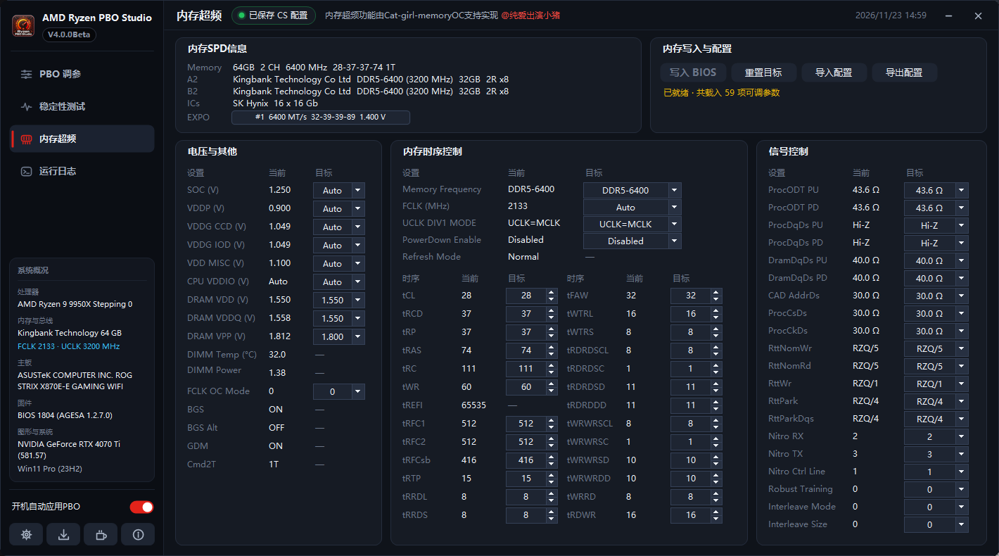

<p align="center">
  <a href="README.md">English</a> ·
  <a href="README_zh_cn.md">简体中文</a> ·
  <a href="README_zh_tw.md">繁體中文</a> ·
  <a href="README_ja.md">日本語</a> ·
  <a href="README_ko.md">한국어</a> ·
  <a href="README_de.md">Deutsch</a> ·
  <a href="README_es.md">Español</a> ·
  <a href="README_fr.md">Français</a> ·
  <strong>Português (Brasil)</strong> ·
  <a href="README_ru.md">Русский</a>
</p>

<h1 align="center">AMD Ryzen PBO Studio</h1>

<p align="center">
  Ferramenta de ajuste PBO, testes automáticos de Curve Optimizer (CO) e overclock de memória para processadores AMD Ryzen séries 5000 / 7000 / 9000.
</p>

<p align="center">
  <a href="https://lengmo23.github.io/RyzenPboStudio/en/"><strong>Guia de uso (em inglês)</strong></a>
</p>


## Recursos

### Interface e monitoramento em tempo real

A barra lateral esquerda alterna entre **Ajuste de PBO**, **Teste de estabilidade**, **OC de memória** e **Log de execução**; abaixo exibe **Visão geral do sistema** (processador, memória e FCLK/UCLK ao vivo, placa-mãe, BIOS e AGESA, driver de vídeo e sistema) e a chave **Aplicar PBO ao iniciar**.

No topo direito fica o painel de monitoramento por núcleo, mostrando:

- Leituras atuais e limites de PPT, TDC, EDC e THM
- TEL/VID, Vdroop, Fmax e BCLK (`BCLK/BCLK2` em clock assíncrono)
- Estado dos núcleos por CCD: uso médio e temperatura hotspot (`HOT`) de cada CCD, além de ranking CPPC (marcadores ouro / prata), frequência, frequência efetiva (`EFF`), valor de CO e Core VID de cada núcleo

### Ajuste de PBO

- **Curve Optimizer (CO)**: offsets por núcleo físico com ajuste `+/-` por coluna, além de aplicar, atualizar, salvar e carregar
- **Curve Shaper (CS)**: 5 faixas de frequência (`MIN` / `LOW` / `MED` / `HIGH` / `MAX`) × 3 faixas de temperatura (`LOW` / `MED` / `HIGH`), apenas em Ryzen série 9000 (Zen 5)
- **Parâmetros PBO e Scalar**: grava FMax, PPT, EDC, TDC e PBO Scalar (1X–10X) juntos
- **Aplicar PBO ao iniciar**: ao ativar, aplica automaticamente a cada logon no Windows os CO / CS salvos e os FMax, PPT, EDC e TDC salvos/aplicados. Passe por um teste de estresse antes de ativar; se o sistema reiniciar de forma anormal após aplicar, a próxima inicialização ignora automaticamente

### Teste de estabilidade


#### Boost single-core e Alinhamento de tensão

Ambas as funções ficam à direita de **Teste de estabilidade** e exigem CPU com AVX2 / FMA:

- **Boost single-core**: mede frequência, frequência efetiva, VID e Core VID de cada núcleo no CO atual sem alterar nenhum parâmetro
- **Alinhamento de tensão**: usa o melhor núcleo de cada CCD como referência, ajusta o CO dos demais núcleos para igualar a tensão na mesma frequência e mede o teto single-core de cada CCD. O resultado apenas preenche o editor de CO sem salvar automaticamente; **passe por um teste de estresse antes de usar**

#### Teste de estresse

O teste de estresse usa **y-cruncher** em três modos:

| Modo       | Descrição                                                                       |
| ---------- | ------------------------------------------------------------------------------- |
| Único      | Escolhe um teste entre VT3, BKT, SVT, BBP, SFTv4, SNT, FFTv4, N63 ou YC018      |
| Sequencial | Executa em ordem; padrão `VT3 → BKT → SVT`, 20 / 10 / 10 rodadas                |
| Combinado  | Alterna os testes escolhidos a cada rodada; padrão `VT3`, `BKT`, `SVT`, 10 rodadas |

Testes, rodadas e duração por rodada podem ser personalizados. `YC018` é um benchmark de Pi intensivo em memória cujo tamanho é escolhido automaticamente conforme a RAM instalada e sempre usa todos os núcleos.

Escopo:

| Escopo           | Descrição                                                        |
| ---------------- | ---------------------------------------------------------------- |
| Todos os núcleos | Estressa todos os núcleos ao mesmo tempo                         |
| Personalizado    | Estressa apenas os núcleos físicos marcados                      |
| CCD único        | Estressa apenas o CCD escolhido (somente CPUs multi-CCD)         |
| Cada CCD         | Executa o teste completo em cada CCD por vez (somente multi-CCD) |

Resultados de CCD único servem só como referência; confirme a estabilidade final com todos os núcleos.

Ajuste de CO:

- **Automático**: quando o y-cruncher relata um erro, mapeia o núcleo lógico afetado ao núcleo físico, recua seu CO (padrão `+2`, ajustável de `+1` a `+5`) e refaz a rodada até passar
- **Manual**: apenas avisa e para o teste sem mudar nenhum parâmetro

### OC de memória

> O recurso de OC de memória é suportado por [Cat-girl-memoryOC](https://v.douyin.com/yMpmAidKqdY/) (`@纯爱出演小猪`).



- **Info SPD da memória**: resumo atual da memória, modelo e capacidade por slot, fabricante dos chips (ICs) e perfis EXPO lidos do SPD
- **Gravação de memória e perfis**: **Gravar na BIOS**, **Reverter**, **Importar**, **Exportar**, com a quantidade de parâmetros ajustáveis carregados e o status atual logo abaixo
- **Tensões e outros**: `SOC`, `VDDP`, `VDDG CCD / IOD`, `VDD MISC`, `CPU VDDIO`, `DRAM VDD / VDDQ / VPP`, média de `DIMM Temp` (sensor SPD) e `DIMM Power` (PMIC; passe o mouse para leituras individuais), `FCLK OC Mode` e itens somente leitura `BGS`, `BGS Alt`, `GDM`, `Cmd2T`. Tensões SoC vêm da PM Table e tensões DRAM do PMIC, atualizadas a cada 2 segundos
- **Controle de timings DRAM**: `Memory Frequency`, `FCLK`, `UCLK DIV1 MODE`, `PowerDown Enable`, `Refresh Mode` e todos os timings do controlador de memória
- **Controle de sinal**: `ProcODT`, drive strengths, `Rtt`, `Nitro`, `Robust Training`, `Interleave`, etc.

#### Preenchimento EXPO e importação / exportação

- **EXPO**: clicar em um perfil EXPO no SPD preenche automaticamente o preset EXPO correspondente; clicar de novo restaura o anterior. É preciso clicar em **Gravar na BIOS** para enviar.
- **Exportar**: salva os alvos atuais em um `.json` na pasta `dram\` (nomeado por plataforma, frequência, CL e fabricante do chip, ex.: `DESKTOP-DDR5-6400-CL28-Hynix.json`). Cada item traz o nome da função `AMD_ACPI` e `"auto": true` ou o `value` bruto da BIOS (`label` e `display` são só para leitura):

```json
{
  "format": "RyzenPboStudio.MemoryConfig",
  "version": 1,
  "source": "targets",
  "memoryType": "DDR5",
  "settings": [
    { "function": "Set Mem Clock", "label": "Memory Frequency", "auto": false, "value": 3200, "display": "DDR5-6400" },
    { "function": "Set VDDIO", "label": "DRAM VDD (V)", "auto": false, "value": 1400, "display": "1.400" },
    { "function": "Set TrrdL", "label": "TrrdL", "auto": true, "display": "Auto" }
  ]
}
```

- **Importar**: aceita arquivos `RyzenPboStudio.MemoryConfig` e configurações de memória do **Cat-girl memoryOC** (configuração de memória ou parte de memória de um perfil combinado). Itens `Auto` voltam ao valor atual da BIOS; opções não suportadas pela placa aparecem na barra de status. Clique em **Reverter** para restaurar todos os alvos aos valores atuais da BIOS

#### Gravar na BIOS

- Os parâmetros são gravados via interface WMI `AMD_ACPI` da placa-mãe. O software não consegue enviar valores Auto
- **Gravar na BIOS** vem bloqueado por padrão; ative primeiro o **Modo avançado** em **Configurações**
- `CPU VDDIO` tem limite de `1.500 V` e precisa de um alvo definido antes de gravar (não pode ficar em Auto)
- A janela de confirmação marca alvos claramente anormais (nos limites mínimo/máximo da BIOS ou ≥2× / ≤0,5× do valor atual). Antes de gravar, verifica IDs de firmware e valores-chave atuais, faz backup dos valores atuais da BIOS em `profiles\memory_backup_<hora>.json` (pode ser reimportado), envia os comandos um a um (parando se houver erro), relê cada item ao final e grava todos os comandos e retornos em `logs\acpi-command-trace.jsonl`
- Após gravar, é preciso **reiniciar e concluir o treinamento de memória** para entrar em vigor. **Parâmetros incorretos podem causar tela preta sem boot**: desktops exigem Clear CMOS; notebooks geralmente não têm botão externo e podem exigir abrir o aparelho para desconectar a bateria principal e a bateria CMOS. O programa não consegue recuperar automaticamente

### Log de execução e recuperação de travamentos


- **Log de execução**: o log completo fica na aba **Log de execução** (com uma janela sincronizada à direita em **Ajuste de PBO**), registrando rodadas e velocidade do y-cruncher, mapeamento de núcleo lógico para físico, recuos de CO e gravações na BIOS; cada inicialização é salva em `logs\`
- **Recuperação de travamentos**: após travamento ou queda de energia durante o teste, o programa inicia automaticamente no boot, restaura os limites PBO e Curve Shaper, recua o CO em um passo (ou mantém o CO manual se alterado após a interrupção) e retoma a etapa interrompida; pode ser cancelado a qualquer momento. Para testes noturnos sem supervisão, ative o logon automático do Windows

### Configurações e idiomas

Clique no **ícone de engrenagem** no canto inferior esquerdo para abrir **Configurações**:

- **Geral**: idioma, confirmar antes de sair e **Modo avançado** (pula avisos rotineiros de teste / recuperação / inicialização e desbloqueia **Gravar na BIOS**)
- **Atualizações**: verificar atualizações ao iniciar
- **Monitor**: intervalo de atualização (`100–10000 ms`, padrão `500 ms`)
- **Dados**: atalhos para abrir `profiles` e `logs`

O inglês é embutido e a pasta `lang\` traz 9 traduções (`zh-Hans`, `zh-Hant`, `ja`, `ko`, `de`, `es`, `fr`, `pt-BR`, `ru`). Por padrão segue o idioma do Windows e usa inglês se não encontrar. Cada `<código>.ini` usa `Texto em inglês=tradução` (mantendo `{0}`, etc.); para adicionar um idioma, copie um arquivo, renomeie e edite `name=` em `[meta]`. A troca vale após reiniciar.

## Requisitos

| Item        | Requisito                                                                                                |
| ----------- | -------------------------------------------------------------------------------------------------------- |
| Processador | AMD Ryzen séries 5000 / 7000 / 9000                                                                      |
| Sistema     | Windows 10 / 11 x64                                                                                      |
| Runtime     | [.NET 8 Desktop Runtime](https://dotnet.microsoft.com/download/dotnet/8.0) (dispensável com `-net8contained.zip`) |
| Driver      | [PawnIO](https://pawnio.eu) (obrigatório; sem ele o programa não inicia)                                 |
| Permissão   | Administrador                                                                                            |

Suporte por geração:

| Recurso         | Série 5000 (Zen 3)          | Série 7000 (Zen 4) | Série 9000 (Zen 5) |
| --------------- | --------------------------- | ------------------ | ------------------ |
| Curve Optimizer | Sim                         | Sim                | Sim                |
| Curve Shaper    | Não                         | Não                | Sim                |
| PPT / EDC / TDC | Sim                         | Sim                | Sim                |
| FMax            | Não                         | Sim                | Sim                |
| Ranking CPPC    | Requer CPPC ativado na BIOS | Sim                | Sim                |

## Como usar

1. Baixe o arquivo correspondente em [Releases](https://github.com/lengmo23/RyzenPboStudio/releases) e extraia em qualquer pasta:
   - **`-lite.zip`**: inclui y-cruncher, precisa de .NET 8 Desktop Runtime instalado
   - **`-net8contained.zip`**: traz .NET 8 Runtime e y-cruncher embutidos, roda direto sem instalar .NET 8
   - `-update.zip` e `-net8patch-rt*.zip` são apenas para atualização automática, não incluem y-cruncher e não servem para a primeira instalação
2. Instale o [PawnIO](https://pawnio.eu) e execute `AMD Ryzen PBO Studio.exe` como administrador
3. Em **Ajuste de PBO**, verifique se frequências por núcleo, CO e leituras de energia estão normais
4. Vá para **Teste de estabilidade**, escolha modo, escopo e ajuste de CO e clique em **Iniciar**
5. Ao passar tudo, o **Log de execução** lista os CO e CS aprovados e o CO final também é gravado em `profiles\final_offsets.txt`
6. Para ajustar memória, vá em **OC de memória**, edite ou importe alvos (ou preencha EXPO), ative o **Modo avançado** em **Configurações**, clique em **Gravar na BIOS** e reinicie para concluir o treinamento de memória

O programa usa três pastas no mesmo diretório:

- `logs\`: logs de cada inicialização, logs do y-cruncher e registros `AMD_ACPI`
- `profiles\`: histórico de CO, estado de recuperação, perfis CO / CS, dados de calibração, configurações e backups de memória da BIOS
- `dram\`: pasta padrão para importar / exportar configurações de OC de memória (presets incluídos também ficam aqui)

## Aviso de riscos

Tanto PBO quanto overclock de memória afetam a estabilidade do sistema. Configurações incorretas podem causar erros de cálculo, travamentos, telas azuis, reinicializações, perda de dados não salvos ou tela preta sem boot (desktops exigem Clear CMOS; notebooks podem exigir abrir para desconectar a bateria principal e a bateria CMOS). Operar instável por longos períodos pode danificar o hardware e afetar a garantia. **Salve seus arquivos antes de testar, não use o PC durante o teste e confira todos os valores-alvo antes de gravar na BIOS.**

Este programa é distribuído sob a GNU General Public License v3.0 (GPL-3.0) **SEM NENHUMA GARANTIA**. O autor não se responsabiliza por perda de dados, danos ao hardware ou outros prejuízos diretos ou indiretos; todos os riscos ficam por conta do usuário.

## Compilando a partir do código-fonte

```powershell
dotnet publish .\RyzenPboStudio\RyzenPboStudio.csproj -c Release -r win-x64 `
  --self-contained false `
  -p:DebugType=None -p:DebugSymbols=false `
  -o .\memoc
```

A saída vai para `memoc\` e a pasta inteira pode ser distribuída diretamente (não é arquivo único). Se `y-cruncher v0.8.7.9547b\` ou `dram-presets\` existirem na raiz do repositório, são copiados automaticamente para `tools\y-cruncher\` e `dram\`; caso contrário essa etapa é ignorada.

## Autor e agradecimentos

- **Desenvolvedor**: [@lengmo23](https://github.com/lengmo23) ([@冷漠OC](https://v.douyin.com/6VGnQBTxwIQ/))
- **Codesenvolvedor (OC de memória)**: [@纯爱出演小猪](https://v.douyin.com/yMpmAidKqdY/) (Cat-girl-memoryOC)
- **Agradecimentos especiais**: `@古腾古腾咕咚咚` (orientação e sugestões), `@阿肝` (ideias e testes), `@Yee` (testes principais)

Copyright © 2026 [@lengmo23](https://github.com/lengmo23)

## Pague um café

AMD Ryzen PBO Studio é uma ferramenta open-source que desenvolvo no meu tempo livre, aprimorando cada recurso ao longo de muitas iterações. Se ela economizou seu tempo de ajuste ou ajudou a extrair mais desempenho do seu PC, sinta-se à vontade para me pagar um café!

O patrocínio é totalmente voluntário e não altera nenhum recurso. Os mesmos códigos de pagamento também ficam no botão de xícara de café no canto inferior esquerdo do programa.

<p align="center">
  
  
</p>

## Licença

Este projeto é distribuído sob a [GNU General Public License v3.0](LICENSE). Como vincula estaticamente o ZenStates-Core (também GPL-3.0), todo o projeto deve ser distribuído sob GPL-3.0.

## Componentes de terceiros

- [ZenStates-Core](https://github.com/irusanov/ZenStates-Core) (GPL-3.0): biblioteca de acesso SMU Ryzen para leitura e escrita de CO, CS, PM Table e PBO
- [SMUDebugTool](https://github.com/irusanov/SMUDebugTool) (GPL-3.0): referência de comandos SMU e layout de PM Table
- [ryzen-smu-cli](https://github.com/rawhide-kobayashi/ryzen-smu-cli) (GPL-3.0): fornece `inpoutx64.dll`
- [y-cruncher](https://www.numberworld.org/y-cruncher/): motor de testes de estresse, copyright Alexander J. Yee
- [PawnIO](https://pawnio.eu): driver de kernel obrigatório instalado separadamente pelo usuário

Consulte [THIRD-PARTY-NOTICES.txt](THIRD-PARTY-NOTICES.txt) para os avisos completos.
