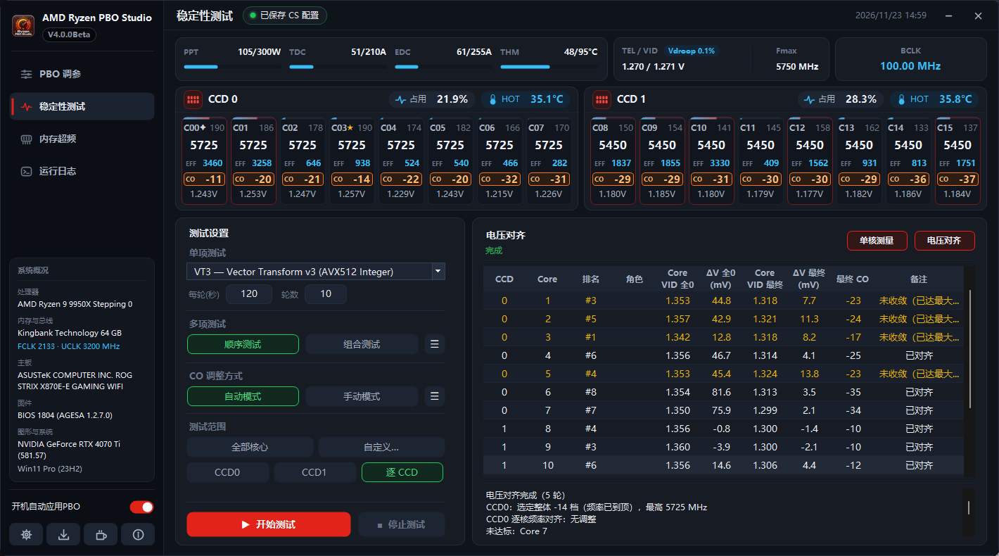

<p align="center">
  <a href="README.md">English</a> ·
  <strong>简体中文</strong> ·
  <a href="README_zh_tw.md">繁體中文</a> ·
  <a href="README_ja.md">日本語</a> ·
  <a href="README_ko.md">한국어</a> ·
  <a href="README_de.md">Deutsch</a> ·
  <a href="README_es.md">Español</a> ·
  <a href="README_fr.md">Français</a> ·
  <a href="README_pt_br.md">Português (Brasil)</a> ·
  <a href="README_ru.md">Русский</a>
</p>

<h1 align="center">AMD Ryzen PBO Studio</h1>

<p align="center">
  面向 AMD Ryzen 5000 / 7000 / 9000 系处理器的 PBO 调节、Curve Optimizer（CO）自动测试与内存超频工具。
</p>

<p align="center">
  <a href="https://lengmo23.github.io/RyzenPboStudio/"><strong>使用指南</strong></a>
</p>


## 功能

### 界面与实时监控

左侧栏用于在 **PBO 调参**、**稳定性测试**、**内存超频** 和 **运行日志** 四个页面间切换，下方显示 **系统概况**（处理器、内存与实时 FCLK/UCLK、主板、BIOS 与 AGESA、显卡驱动及系统）、**开机自动应用PBO** 开关。

右侧顶部是每核监控面板，显示：

- PPT、TDC、EDC、THM 的当前值与上限
- TEL/VID、Vdroop、Fmax 与 BCLK（异步外频时显示为 `BCLK/BCLK2`）
- 按 CCD 分组的核心状态：各 CCD 平均占用率与热点温度（`HOT`），以及每核 CPPC 排名（金 / 银核标记）、频率、有效频率（`EFF`）、CO 值与 Core VID

### PBO 调参

- **Curve Optimizer（CO）**：按物理核心设置偏移值，支持整列 `+/-` 调节，以及应用、刷新、保存与读取配置
- **Curve Shaper（CS）**：5 个频率档（`MIN` / `LOW` / `MED` / `HIGH` / `MAX`）× 3 个温度档（`LOW` / `MED` / `HIGH`），仅 Ryzen 9000 系（Zen 5）支持
- **PBO 参数与 Scalar**：同时写入 FMax、PPT、EDC、TDC 与 PBO Scalar（1X–10X）
- **开机自动应用 PBO**：开启后每次登录 Windows 会自动写入已保存的 CO / CS 和保存应用的 FMax、PPT、EDC、TDC。启用前请先通过压力测试；若应用后系统异常重启，下次开机将自动跳过

### 稳定性测试



#### 单核测量与电压对齐

两项功能在 **稳定性测试** 页右侧，要求 CPU 支持 AVX2 / FMA：

- **单核测量**：逐核测出当前 CO 下的频率、有效频率、VID 与 Core VID，不修改任何参数
- **电压对齐**：以每个 CCD 中体质最好的核心为基准，调整其余核心的 CO，使各核心在同频下的电压趋于一致，并测出各 CCD 的单核频率上限。结果只填入 CO 编辑器，不会自动保存，**使用前必须通过压力测试**

#### 压力测试

压力测试使用 **y-cruncher**，支持三种方式：

| 方式     | 说明                                                             |
| -------- | ---------------------------------------------------------------- |
| 单项测试 | 从 VT3、BKT、SVT、BBP、SFTv4、SNT、FFTv4、N63、YC018 中任选一项  |
| 顺序测试 | 按顺序逐项运行，默认 `VT3 → BKT → SVT`，各 20 / 10 / 10 轮   |
| 组合测试 | 每轮内轮换运行所选项目，默认 `VT3`、`BKT`、`SVT`，共 10 轮 |

各方式的项目、轮数与每轮时长都可自定义。`YC018` 是内存密集型 Pi 基准测试，规模按内存容量自动选择，固定使用全部核心。

测试范围：

| 范围     | 说明                                           |
| -------- | ---------------------------------------------- |
| 全部核心 | 所有核心同时参与压测                           |
| 自定义   | 手动勾选参与压测的物理核心                     |
| 单个 CCD | 只压测指定的 CCD（仅多 CCD 处理器）            |
| 逐 CCD   | 依次对每个 CCD 完整测试一遍（仅多 CCD 处理器） |

单 CCD 结果仅供参考，最终稳定性请以全核测试为准。

CO 调整方式：

- **自动模式**：y-cruncher 报错时，把出错的逻辑核心映射回物理核心，回退该核 CO（默认 `+2`，可在 `+1～+5` 间设置）并重跑整轮，直到通过
- **手动模式**：报错时仅提示并停止测试，不改动任何参数

### 内存超频

> 内存超频功能由 [Cat-girl-memoryOC](https://v.douyin.com/yMpmAidKqdY/)（`@纯爱出演小猪`）支持实现。


- **内存 SPD 信息**：当前内存汇总、各插槽内存条型号与容量、颗粒厂商（ICs），以及从 SPD 读出的 EXPO 档位
- **内存写入与配置**：**写入 BIOS**、**重置目标**、**导入配置**、**导出配置**，下方显示已载入的可调参数数量与当前状态
- **电压与其他**：`SOC`、`VDDP`、`VDDG CCD / IOD`、`VDD MISC`、`CPU VDDIO`、`DRAM VDD / VDDQ / VPP`、平均 `DIMM Temp`（SPD 温度传感器）与 `DIMM Power`（PMIC，悬停可看单条读数）、`FCLK OC Mode`，以及只读项 `BGS`、`BGS Alt`、`GDM`、`Cmd2T`。SoC 侧电压取自 PM Table，内存电压取自 PMIC，每 2 秒刷新一次
- **内存时序控制**：`Memory Frequency`、`FCLK`、`UCLK DIV1 MODE`、`PowerDown Enable`、`Refresh Mode`，内存控制器的全部时序
- **信号控制**：`ProcODT`、驱动强度、`Rtt`、`Nitro`、`Robust Training`、`Interleave` 等选项

#### EXPO 填充与配置导入 / 导出

- **EXPO**：点击 SPD 中的 EXPO 档位，会自动填入对应的 EXPO 预设，再次点击复原。需点击 **写入 BIOS** 才会下发。
- **导出配置**：把当前目标保存为 `.json` 文件，默认存放在 `dram\` 目录（按平台、频率、CL 与颗粒命名，如 `DESKTOP-DDR5-6400-CL28-Hynix.json`）。每条记录包含 `AMD_ACPI` 函数名，以及 `"auto": true` 或原始 BIOS `value`（`label` 与 `display` 仅供阅读）：

```json
{
  "format": "RyzenPboStudio.MemoryConfig",
  "version": 1,
  "source": "targets",
  "memoryType": "DDR5",
  "settings": [
    { "function": "Set Mem Clock", "label": "Memory Frequency", "auto": false, "value": 3200, "display": "DDR5-6400" },
    { "function": "Set VDDIO", "label": "DRAM VDD (V)", "auto": false, "value": 1400, "display": "1.400" },
    { "function": "Set TrrdL", "label": "TrrdL", "auto": true, "display": "Auto" }
  ]
}
```

- **导入配置**：支持本程序导出的 `RyzenPboStudio.MemoryConfig` 文件，以及 **Cat-girl memoryOC** 的内存配置（独立内存配置或组合配置中的内存部分）。`Auto` 项会恢复为当前 BIOS 设定，主板 BIOS 不支持的项目会在状态栏提示。点击 **重置目标** 可将所有目标恢复为当前 BIOS 值

#### 写入 BIOS

- 参数通过主板 `AMD_ACPI` WMI 接口写入。软件无法下发Auto值
- **写入 BIOS** 默认锁定，需先在 **设置** 中开启 **专家模式**
- `CPU VDDIO` 上限为 `1.500 V`，写入前必须指定目标值，不能保持 Auto
- 确认窗口会标出明显异常的目标（触及 BIOS 上下限，或达到当前值的 2 倍及以上 / 一半及以下）。写入前会校验固件函数 ID 与关键项当前值，自动将当前 BIOS 值备份到 `profiles\memory_backup_<时间>.json`（可导入还原）；命令逐项发送，出错即停止，完成后逐项回读，所有原始命令与返回记录在 `logs\acpi-command-trace.jsonl`
- 写入后需 **重启并完成内存训练** 才会生效。**错误的参数可能导致黑屏无法开机**：台式机需清除 CMOS，笔记本通常没有外部重置键，可能需要拆机断开主电池与 CMOS 电池，程序无法自动恢复

### 运行日志与死机恢复


- **运行日志**：完整日志在 **运行日志** 页查看（**PBO 调参** 页右侧也有同步的小窗口），记录 y-cruncher 轮次与测速、逻辑核到物理核的报错映射、CO 回退和 BIOS 写入记录；每次启动都会保存到 `logs\`
- **死机恢复**：测试中途死机或断电重启后，程序随开机自动启动，恢复 PBO 限制与 Curve Shaper，将 CO 回退一档（若中断后已手动改过 CO 则按手动值继续）并从中断阶段续跑，期间可随时取消。无人值守过夜测试请在 Windows 中开启自动登录

### 设置与语言

点击左侧栏底部的 **齿轮图标** 打开 **设置**：

- **常规**：语言、退出前确认，以及 **专家模式**（跳过常规测试 / 恢复 / 开机应用弹窗，并解锁 **写入 BIOS**）
- **更新**：启动时自动检查更新
- **监控**：刷新间隔（`100～10000 ms`，默认 `500 ms`）
- **数据**：快捷打开 `profiles` 和 `logs` 目录

程序内置英文，`lang\` 目录自带 9 种语言翻译（简体中文 `zh-Hans`、繁体中文 `zh-Hant`、日语 `ja`、韩语 `ko`、德语 `de`、西班牙语 `es`、法语 `fr`、巴西葡萄牙语 `pt-BR`、俄语 `ru`），默认跟随 Windows 显示语言，找不到时用英文。每个 `<语言代码>.ini` 按 `英文原文=译文` 编写（需保留 `{0}` 等占位符）；新增语言只需复制一份文件、按语言代码改名并修改 `[meta]` 下的 `name=`。切换语言后重启生效。

## 运行要求

| 项目     | 要求                                                                                                              |
| -------- | ----------------------------------------------------------------------------------------------------------------- |
| 处理器   | AMD Ryzen 5000 / 7000 / 9000 系                                                                                   |
| 操作系统 | Windows 10 / 11 x64                                                                                               |
| 运行库   | [.NET 8 Desktop Runtime](https://dotnet.microsoft.com/download/dotnet/8.0)（下载 `-net8contained.zip` 时免安装） |
| 驱动     | [PawnIO](https://pawnio.eu)（必需，未安装时程序无法启动）                                                          |
| 权限     | 管理员                                                                                                            |

各代处理器的功能支持情况：

| 功能            | 5000 系（Zen 3）      | 7000 系（Zen 4） | 9000 系（Zen 5） |
| --------------- | --------------------- | ---------------- | ---------------- |
| Curve Optimizer | 支持                  | 支持             | 支持             |
| Curve Shaper    | 不支持                | 不支持           | 支持             |
| PPT / EDC / TDC | 支持                  | 支持             | 支持             |
| 修改 FMax       | 不支持                | 支持             | 支持             |
| CPPC 核心排名   | 需在 BIOS 中开启 CPPC | 支持             | 支持             |

## 使用方法

1. 从 [Releases](https://github.com/lengmo23/RyzenPboStudio/releases) 下载对应压缩包并解压到任意目录：
   - **`-lite.zip`**：含 y-cruncher，需系统已安装 .NET 8 Desktop Runtime
   - **`-net8contained.zip`**：内置 .NET 8 运行时与 y-cruncher，未安装 .NET 8 可直接运行
   - `-update.zip` 与 `-net8patch-rt*.zip` 仅供程序内自动更新使用，不含 y-cruncher，请勿用于首次安装
2. 安装 [PawnIO](https://pawnio.eu)，然后以管理员身份运行 `AMD Ryzen PBO Studio.exe`
3. 在 **PBO 调参** 页确认每核频率、CO 值和功耗读数正常
4. 切换到 **稳定性测试** 页，选好测试方式、范围和 CO 调整方式，点击「开始测试」
5. 全部通过后，**运行日志** 会列出通过的 CO 与 CS 数值，最终 CO 同时写入 `profiles\final_offsets.txt`
6. 如需调内存，切换到 **内存超频** 页编辑或导入目标（也可先填 EXPO），在 **设置** 中开启 **专家模式** 后点「写入 BIOS」，重启完成内存训练即可生效

程序会在同目录使用三个文件夹：

- `logs\`：每次启动的运行日志、y-cruncher 日志，以及 `AMD_ACPI` 探测与写入记录
- `profiles\`：CO 历史、恢复状态、CO / CS 配置、校准数据、设置与 BIOS 内存备份
- `dram\`：内存超频配置的默认导入 / 导出目录（随包附带预设时也放在这里）

## 风险提示

PBO 和内存超频都属于超频操作，会影响系统稳定性。设置不当可能导致运算错误、死机、蓝屏、重启、未保存数据丢失，或因内存参数不当导致黑屏无法开机（台式机需清除 CMOS，笔记本可能需要拆机断开主电池与 CMOS 电池）。长期在不稳定状态下运行可能损伤硬件，也可能影响保修。**测试前请保存资料，测试期间请勿操作电脑，写入 BIOS 前请核对好所有目标值。**

本程序依据 GNU 通用公共许可证第 3 版（GPL-3.0）发布，**不附带任何形式的担保**，包括但不限于对适销性或特定用途适用性的默示担保。因使用本程序导致的任何数据丢失、硬件损坏或其他直接、间接损失，作者概不负责，相关风险由使用者自行承担。

## 从源码构建

```powershell
dotnet publish .\RyzenPboStudio\RyzenPboStudio.csproj -c Release -r win-x64 `
  --self-contained false `
  -p:DebugType=None -p:DebugSymbols=false `
  -o .\memoc
```

构建产物输出到 `memoc\`，整个目录可直接分发（非单文件）。若仓库根目录存在 `y-cruncher v0.8.7.9547b\` 或 `dram-presets\`，构建时会自动复制到发布目录的 `tools\y-cruncher\` 与 `dram\`；不存在时自动跳过。

## 作者与致谢

- **开发者**：[@lengmo23](https://github.com/lengmo23)（[@冷漠OC](https://v.douyin.com/6VGnQBTxwIQ/)）
- **联合开发者（内存超频）**：[@纯爱出演小猪](https://v.douyin.com/yMpmAidKqdY/)（Cat-girl-memoryOC）
- **特别鸣谢**：`@古腾古腾咕咚咚`（指导与建议）、`@阿肝`（功能建议与测试）、`@Yee`（核心测试）

Copyright © 2026 [@lengmo23](https://github.com/lengmo23)

## 请作者喝杯咖啡

AMD Ryzen PBO Studio 是我利用业余时间独立开发的开源工具，每一个功能都经过日夜打磨与反复迭代。如果它帮你节省了反复调参的时间，或让你的电脑获得了更好的性能，欢迎请我喝杯咖啡！你的每一份支持，都是我持续维护和更新的动力，也能让更多玩家用上更好的调参工具。

赞助完全自愿，不影响任何功能的使用。程序左下角的咖啡杯按钮中也提供相同的收款码。

<p align="center">
  
  
</p>

## 许可

本项目依据 [GNU General Public License v3.0](LICENSE) 发布。由于项目静态链接了同为 GPL-3.0 的 ZenStates-Core，整个项目也必须以 GPL-3.0 发布。

## 第三方组件

- [ZenStates-Core](https://github.com/irusanov/ZenStates-Core)（GPL-3.0）：Ryzen SMU 访问库，提供 CO、CS、PM Table 与 PBO 参数的读写接口
- [SMUDebugTool](https://github.com/irusanov/SMUDebugTool)（GPL-3.0）：SMU 命令定义与 PM Table 布局的参考实现
- [ryzen-smu-cli](https://github.com/rawhide-kobayashi/ryzen-smu-cli)（GPL-3.0）：提供 `inpoutx64.dll` 硬件访问组件
- [y-cruncher](https://www.numberworld.org/y-cruncher/)：压力测试引擎，版权归 Alexander J. Yee 所有
- [PawnIO](https://pawnio.eu)：必需的内核驱动组件，由用户单独安装

完整声明见 [THIRD-PARTY-NOTICES.txt](THIRD-PARTY-NOTICES.txt)。
